# Manual de despliegue de la aplicación de gestión de libros

**Proyecto:** AdrianOthman

## 1. Introducción

En este documento se explica cómo instalar y poner en funcionamiento la aplicación de gestión de libros. Esta permite realizar distintas operaciones con los libros, como añadirlos, consultarlos, modificarlos o eliminarlos.

## 1.2 Preparación de la máquina virtual

- Aquí estare usando una MV limpia como referencia

### 1.3. Estado inicial

Aqui mandare capturas de que la MV está recien creada y que no hay trampas ni cartón.

**Captura 1.** Estado inicial de la máquina virtual.
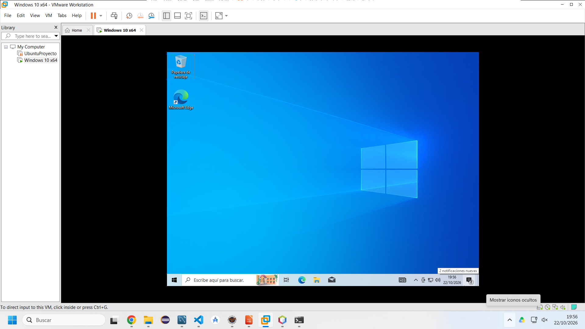

### 1.4. Comprobar el sistema operativo

Aquí compruebo que el sistema operativo está instalado y su versión.

**Captura 2.** Información del SO de la máquina virtual.

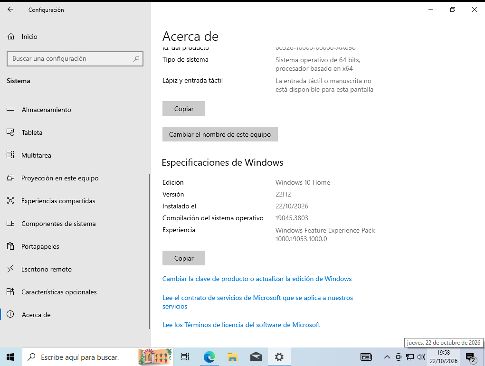

## 2. Instalación de Java JDK

Java es necesario para compilar y ejecutar la aplicación.

### 2.1. Descargar e instalar Java

Primero se accede a la página oficial de descarga de Java y se descarga una versión del JDK compatible con el proyecto, en este caso es el JDK 26.0.2.

Para instalarlo seguimos estos pasos:

- Abre este enlace [Java 26.0.2.1](https://www.oracle.com/java/technologies/javase/jdk26-archive-downloads.html)


**Captura 3.** Descarga o instalación del JDK.

- Dale click al último y se descargará un archivo 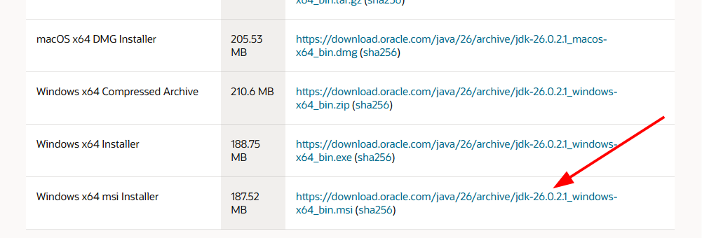

- Abres el .msi y le das a next todo el rato, aquí le das a "Sí" y esperas a que se instale

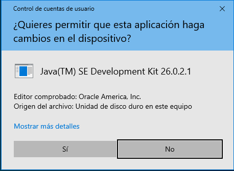

## Con esto ya tienes  *Java* instalado

## 3. Instalación de Git

Git se utiliza para descargar el proyecto desde su repositorio y obtener sus archivos.

### 3.1. Descargar e instalar Git

Entras en la página oficial de [Git](https://git-scm.com/install/windows) y descargas el instalador para Windows. Le das al primero, ejecutas y le das a siguiente todo el rato.

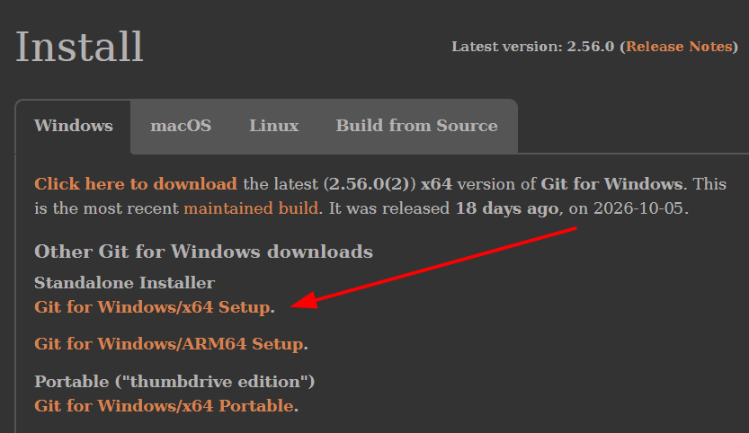

### 3.2. Comprobar que se ha instalado correctamente

Una vez finalizado la instalación, abres una terminal y ejecutas esto:

```cmd
git --version
```
- Te tendria que aparecer así:

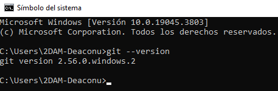

## 4. Instalación de NetBeans

NetBeans será el entorno utilizado para abrir el proyecto y ejecutar la aplicación.

### 4.1. Descargar e instalar NetBeans

Descargas [NetBeans](https://netbeans.apache.org/front/main/download/nb31/) desde su página oficial. Hay que elegir una versión compatible con el JDK instalado y con la versión de Java que utiliza el proyecto.

Le das al primero, descargas el .zip y extraes todo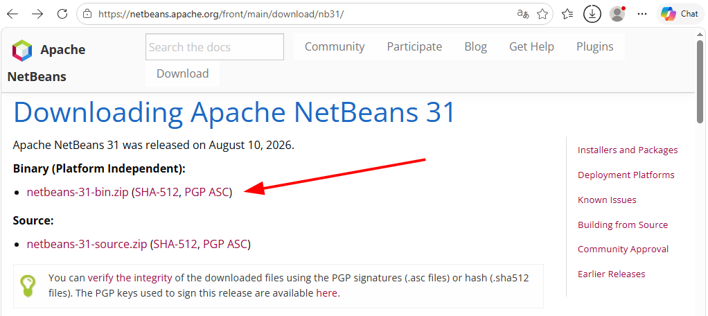
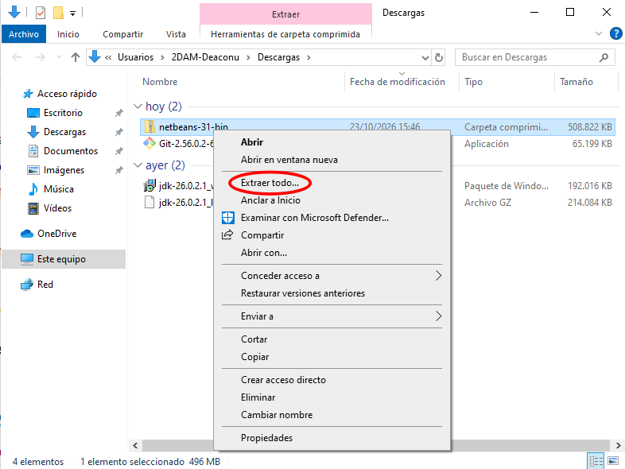

Al finalizar abres la carpeta, vas a netbeans, bin y ejecutas netbeans64.exe para que se instala todo bien.
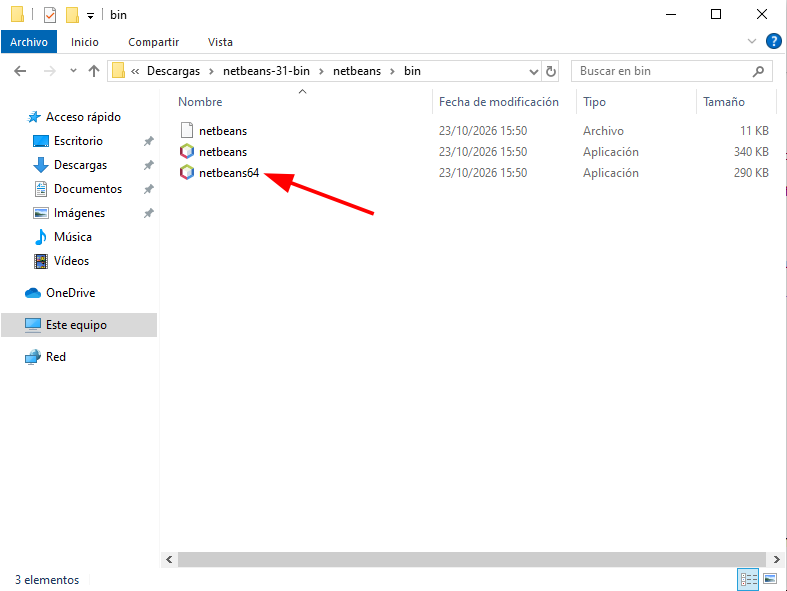

## 5. Instalación y configuración de MySQL

MySQL se utiliza para guardar los libros en una base de datos y poder realizar las operaciones desde la aplicación.

### 5.2. Instalar Visual Studio

Por alguna razón tienes que instalar primero Visual Studio para instalar MySQL Community Server, vas a esta [página](https://visualstudio.microsoft.com/insiders/?rwnlp=es) y descargas la version de Windows. 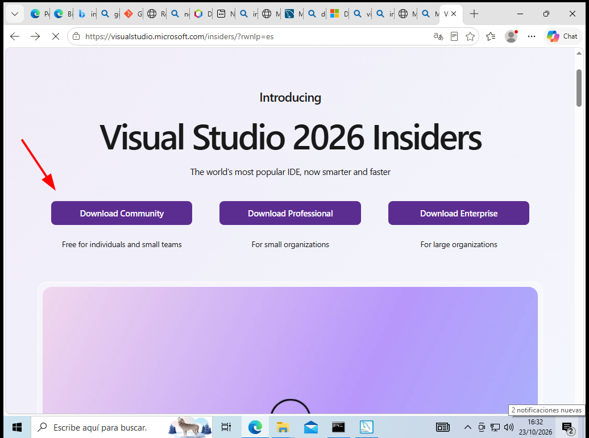
Ejecutas el instalador y le das a next todo el rato.

### 5.1. Instalar MySQL Server

Descargas [MySQL Server](https://dev.mysql.com/downloads/mysql/?platform&os=3/) desde su página oficial y se inicia el instalador de windows. 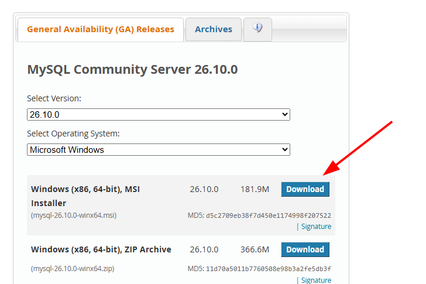 

Le das al primero, le das a seguir con mi descarga, ejecutas el instalador y le das a siguiente.

Ahora sigues estos pasos:
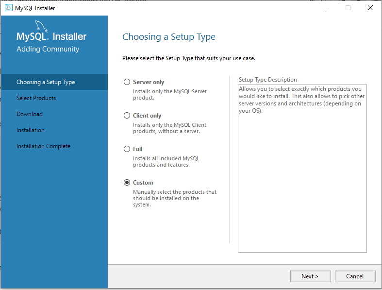
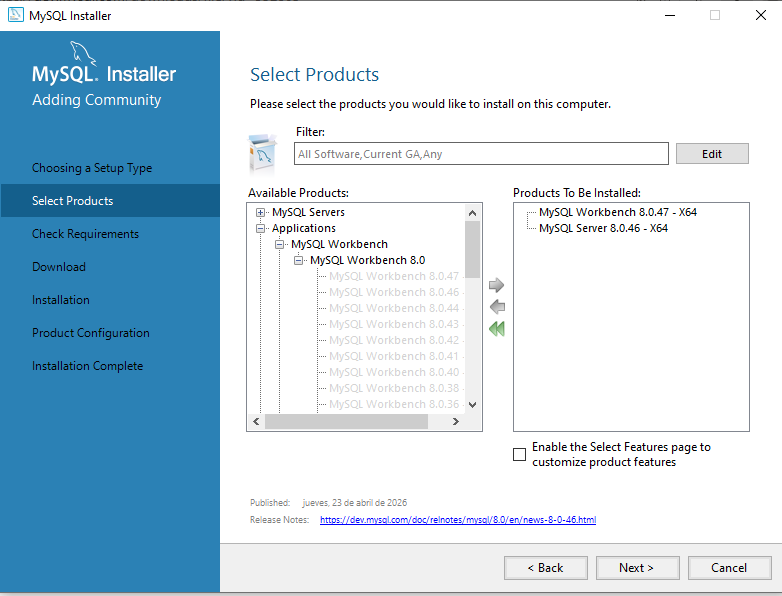
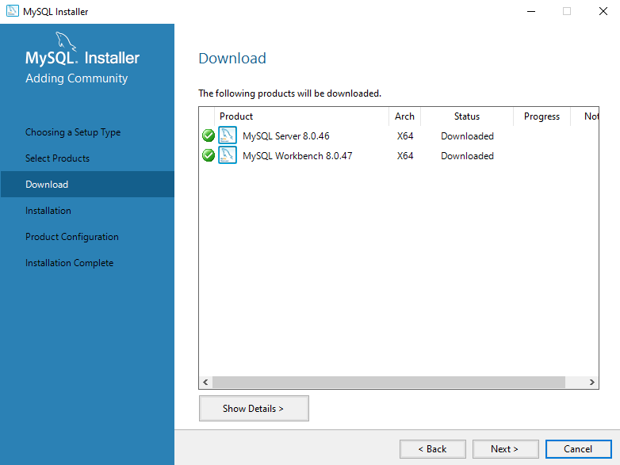
Ejecutas, y una vez terminado de momento le das a siguiente todo el rato.

Aquí pones la contraseña que quieras, por ejemplo, yo he puesto "root". 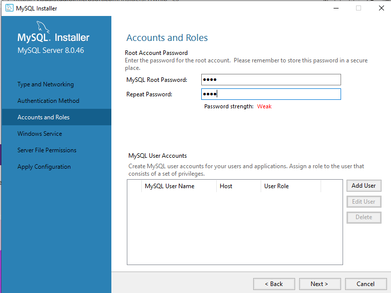

Luego ejecutas todo lo que te pida y ya esta. 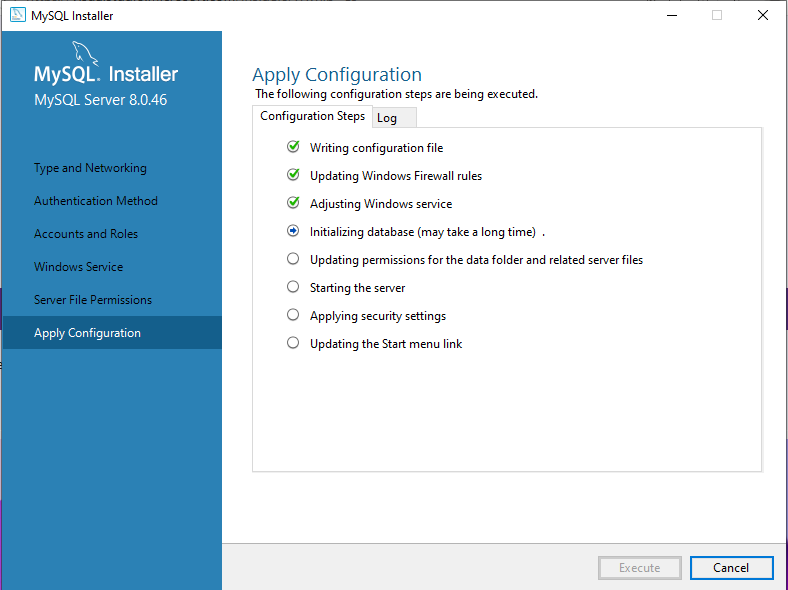

### 5.2. Abrir MySQL Workbench

Abres MySQL Workbench y sigues estos pasos para ver si esta ejecutado correctamente.

En la página principal bajas un poco y le das click a la base de datos.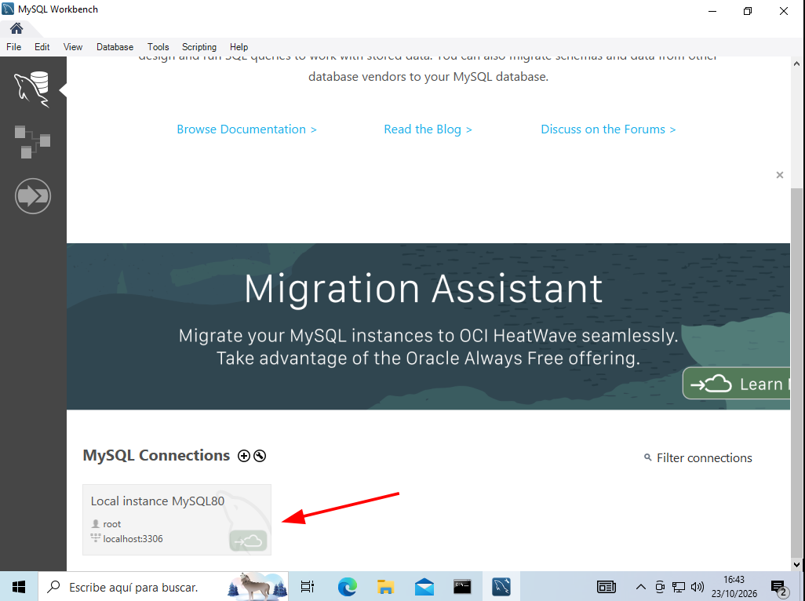

Ahora te pedirá la contraseña que has puesto anteriormente y le das a guardas contraseña para no volver a ponerla mas. 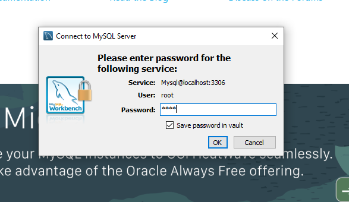

## 6. Github

En este paso tienes que entrar en Github y copiar la URL del repositorio.

Entras al proyecto ya compartido, le das a "Code" y copias desde HTTPS. 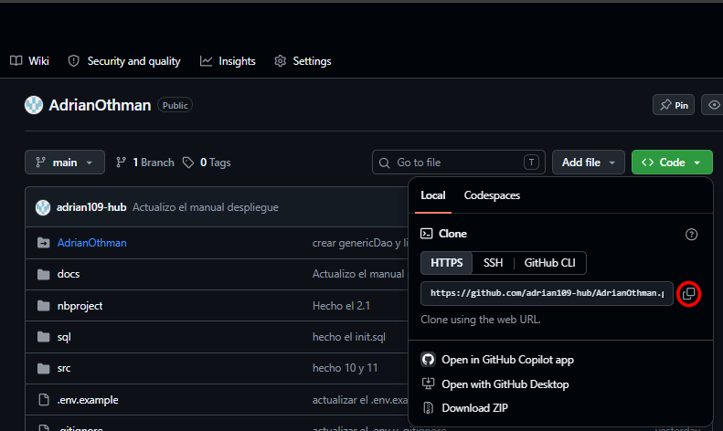

## 7. Descargar el proyecto

### 7.1. Clonar el repositorio

Una vez todo hecho tenemos que ir a NetBeans y clonar el repositorio.

Para ello le damos a Team-Git-Clone...
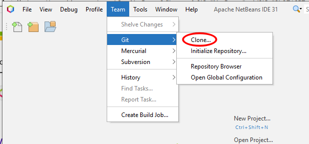

Aquí pegamos la URL del repositorio de Github, ponemos nuestro usuario y contraseña, y dejamos la ruta tal cual esta. 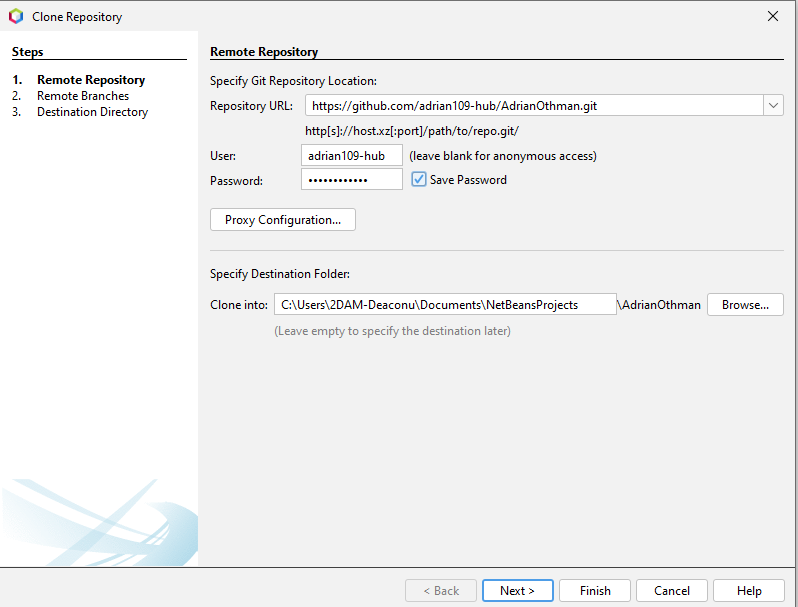

A partir de aqui le das a next y ya tendrias el proyecto en Netbeans.

### 7.2. Instalar las librerias

Cuando ya tengamos el proyecto vamos a libreries, click derecho y Add JAR/Folder.

Aqui añadimos ambos archivos y ya las tendremos añadidas. 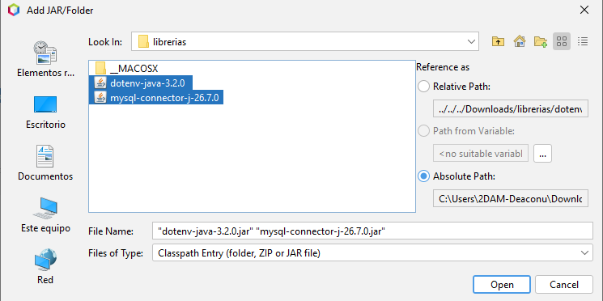

### 7.3. Conectar Git con el proyecto

Para conectarlo con Git, vas a la terminal, te pones en el repositorio y haces pones:

```cmd
git clone (URL del repositorio)
```
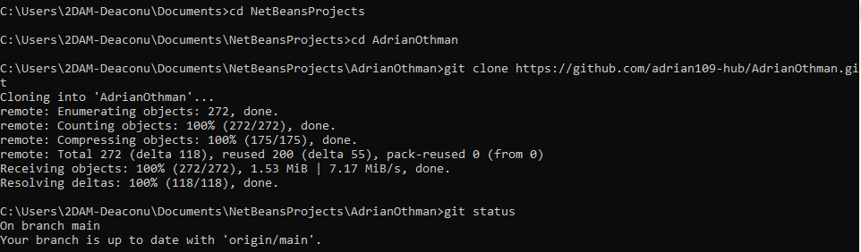

Cuando hagas algun commit o algo te pedira identificarte con tu correo y usuario, y luego desde un navegador o un código.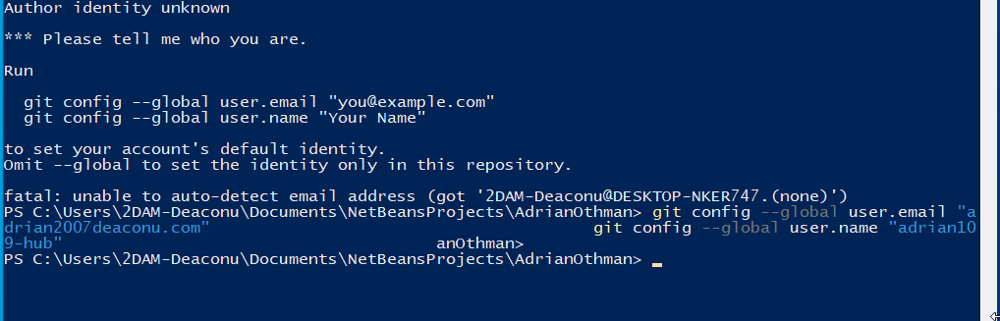
## 8. Crear la base de datos

### 8.1. Crear la base de datos

Abre MySQL Workbench y la conectas a la Database, dandole a Database arriba y dejandolo así: 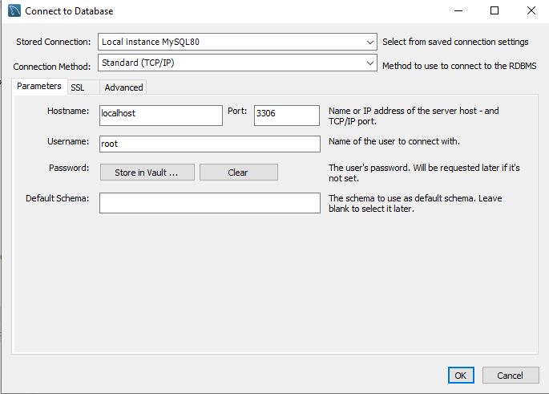

Si hace falta salir del modo seguro insertamos este comando primero:
```sql
SET SQL_SAFE_UPDATE=0
```

Ejecutas la siguiente consulta para crear la base de datos:
```sql
CREATE DATABASE IF NOT EXISTS librorepositorymysql
  CHARACTER SET utf8mb4
  COLLATE utf8mb4_general_ci;

USE librorepositorymysql;

CREATE TABLE IF NOT EXISTS libro (
  id VARCHAR(50) PRIMARY KEY,
  titulo VARCHAR(200) NOT NULL,
  autor VARCHAR(150) NOT NULL,
  precio DOUBLE NOT NULL,
  stock INT NOT NULL
);

DELETE FROM libro;

INSERT INTO libro (id, titulo, autor, precio, stock)
VALUES
('1', 'Don Quijote de la Mancha', 'Miguel de Cervantes', 19.99, 10),
('2', 'Cien años de soledad', 'Gabriel García Márquez', 15.50, 7),
('3', 'El principito', 'Antoine de Saint-Exupéry', 12.00, 15);
```
Y comprobamos que funcione:
```sql
SELECT * FROM libro;
```

Si aparece los libros insertados, significa que la base esta bien hecha.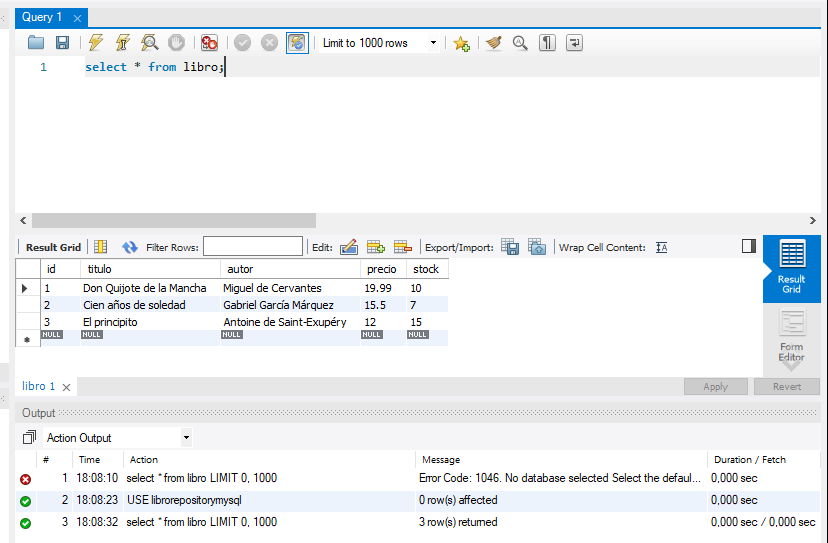


## 9. Configurar la conexión de Java con MySQL

La clase `ConexionDB` es la encargada de obtener la conexión con la base de datos.

Entonces desde Netbeans vas a Files y seleccionas .env.example y copias todo. 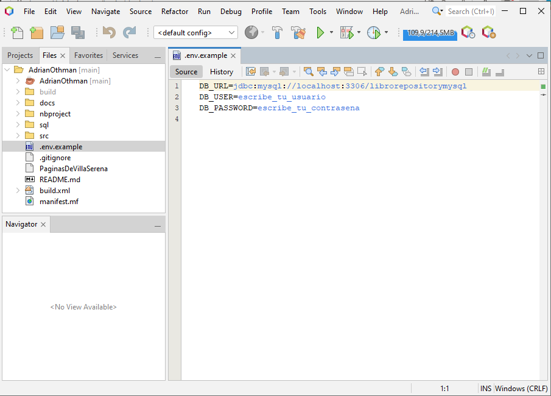

Luego copias .env.example desde el gestor de archivos, y cambias el nombre a `.env`.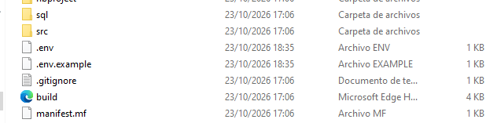

Pegamos todo en el .env y cambiamos los datos de ejemplo con los nuestros de MySQL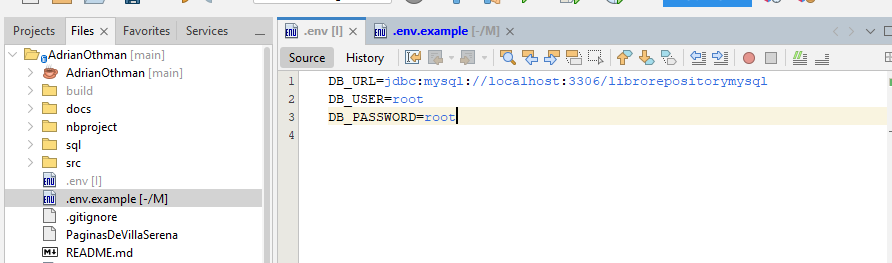

## 10. Ejecutar la aplicación

Cuando todo esté configurado, probamos a ejecutar el main desde Netbeans.

Seleccionamos el main y pulsamos ejecutar. Si la aplicación utiliza un menú por consola, aparecerán las opciones disponibles para trabajar con los libros.

Aquí un ejemplo para mostrar todos los libros: 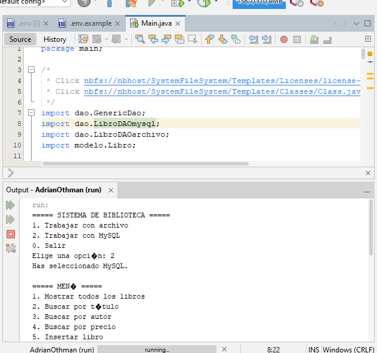 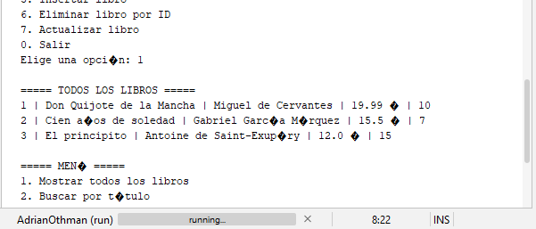

## 11. Comprobar el funcionamiento

Para comprobar que se ha realizado correctamente, vamos a realizar algunas operaciones.

| Prueba | Resultado esperado |
|---|---|
| Buscar por autor | Se muestran los libros de ese autor. |
| Insertar un libro | Se guarda el nuevo libro. |
| Actualizar un libro | Se actualizan sus datos. |
| Eliminar un libro | Deja de aparecer en las consultas. |
| Buscar por título o autor | Se muestran las coincidencias encontradas. |
| Buscar por precio | Aparecen los libros dentro del intervalo indicado. |

Capturas de algunas:
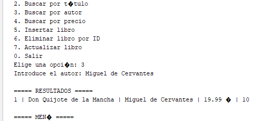
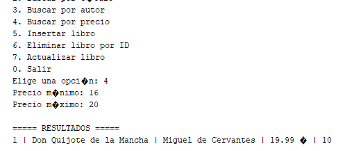

## 12. Problemas que pueden aparecer

Durante el manual pueden aparecer errores que impidan que funciones bien. Algunos de los más habituales son los siguientes:

| Problema | Posible solución |
|---|---|
| Java no se reconoce | Comprobar bien si el JDK esta bien instalado. |
| Git no funciona | Revisar que se haya instalado correctamente. |
| Netbeans no reconoce el proyecto | Comprobar la carpeta seleccionada y la versión de Java y que sea compatible. |
| No se conecta a MySQL | Comprobar que el servidor está iniciado y revisar si tienes bien el .env. |
| No existe la tabla libro | Ejecutar las consultas SQL dichas anteriormente. |
| La aplicación no encuentra libros | Comprobar que existen registros y que la Database esta conectada. |


## 13. Conclusión

En este manual se han explicado los pasos necesarios para que un compañero se pueda conectar correctamente, instalar las apps, descargar el proyecto y configurar la base de datos y conectarse a ella.

Se ha ejecutado la aplicación y se han muchas pruebas para comprobar que se trabaja perfecto con SQL.

Todas las capturas estan hechas desde la MV para ver el proceso y comprobar los resultados de cada instalación y configuración.